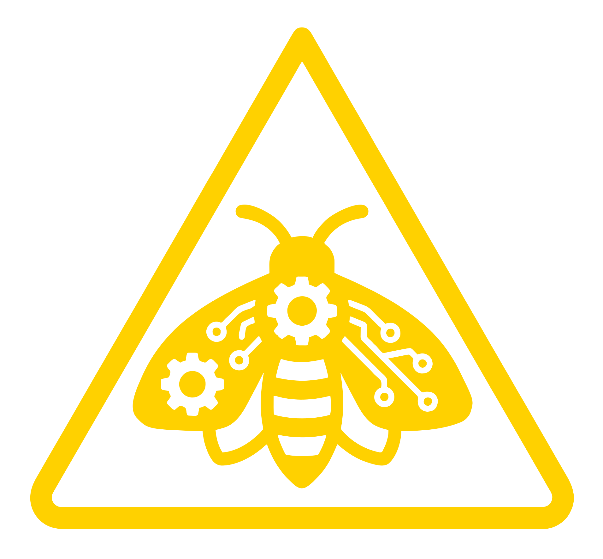

# Talk slides — CLAUDE.md

The talk is a single self-contained HTML file: `talk/index.html`. No build step, no framework — edit it directly and reload in the browser.

Preview via the project's dev server (port 8731):
```
python3 -m http.server 8731
```
Then open `http://localhost:8731/talk/`.

---

## Architecture

**All CSS and JS is inline** in `index.html`. The deck is a full-viewport flex container (`.deck > .track > .slide`). Navigation moves the track with `transform: translateX(-N * 100%)`.

```
.deck            — overflow:hidden, full viewport
  .track         — flex row, transitions on transform
    .slide×5     — flex:0 0 100%, full height
```

**Transition:** `0.45s cubic-bezier(0.65, 0, 0.35, 1)` push. An `isAnimating` flag (reset after 460ms) prevents rapid-fire skipping.

**Navigation inputs:**
- Keyboard: `←` `→` `↑` `↓` `Space` `PageUp/Down` `Home` `End`
- Touch: swipe horizontally, threshold 40px, ignored if vertical swipe dominates
- Click: left/right 20% tap zones (`.tap-prev` / `.tap-next`)
- Dots: `.nav-dots` → `goTo(i)` on click

**UI chrome (all `position:fixed`):**
- `.progress-bar` — 2px top bar, width = `(slide+1)/total * 100%`
- `.counter` — top-right, e.g. `1 / 5`
- `.nav-dots` — bottom-centre dot row
- `.key-hint` — bottom-left keyboard hint, hidden on mobile

---

## Design tokens (CSS custom properties on `:root`)

```css
--bg:            #0A0A0A   /* near-black background */
--panel:         #121212
--ink:           #F5F3EF   /* off-white text */
--ink-dim:       #9A9A9A   /* secondary text */
--ink-faint:     #6A6A6A   /* tertiary / rules */
--rule:          #242424   /* divider lines */

/* Category accent colours */
--cat-output:         #3D8BFF   /* Output Risks */
--cat-process:        #FFD100   /* Process Distortion */
--cat-overtrust:      #FF6B00   /* Overtrust */
--cat-deskilling:     #FF3B30   /* Deskilling */
--cat-accountability: #B8B8AE   /* Accountability */

--font-display: "Big Shoulders Display", Impact, sans-serif
--font-body:    "JetBrains Mono", ui-monospace, monospace
```

Sizes use `clamp(min, fluid, max)` throughout so the deck scales from phone to projector without media queries (except for the closing slide's column/row flip at 639px and hiding the key-hint on mobile).

---

## Hazard stripe

Each slide starts with a `.stripe` div. The colour is set per-slide via `--accent`:

```html
<div class="stripe" style="--accent: var(--cat-process)"></div>
```

Default `--accent` falls back to `var(--ink)` (white). The stripe is `10px` tall (6px on mobile).

---

## Moth mark (Slide 1)

The moth on the title slide is an `` tag pointing at `../data/moth-icon.svg`. The SVG has an opaque background rect, so a CSS mask approach does **not** work (the rect makes the entire mask area solid). Use `` only.

```html

```

---

## Authoring workflow — outline.md → index.html

`outline.md` is the **source of truth** for slide content. Write slides there, then ask Claude to sync to `index.html`.

### outline.md format

Each slide is separated by `---`. The heading line carries layout and accent tags:

```markdown
---
# Slide heading [layout: name] [accent: token]
Body content…
```

- **`[layout: name]`** — which slide template to use (see table below)
- **`[accent: token]`** — stripe colour; one of `ink`, `output`, `process`, `overtrust`, `deskilling`, `accountability` (maps to the CSS custom properties)

### Available layouts

| `[layout: X]` | HTML class | Description |
|---|---|---|
| `title` | `.slide--title` | Big hero title, moth mark, subtitle, byline |
| `bio` | `.slide--bio` | Heading + timeline list (year, event, optional `current` marker) |
| `quote` | `.slide--quote` | Full-bleed blockquote with attribution |
| `overview` | `.slide--overview` | Intro text + multi-row list (`name \| tagline \| count`) |
| `section` | `.slide--section` | Category name + large accent stripe — section transition slide |
| `content` | `.slide--content` | Heading + body text / bullet points |
| `columns` | `.slide--columns` | Heading + 2/3/4 equal columns, each with title and body |
| `closing` | `.slide--closing` | URL, social handles, QR code |

### overview rows

Use pipe notation in the outline — Claude converts each row to a `.layer-row`:

```
- Output Risks | What comes out is compromised. | 3
```

### columns layout

Add `[cols: 2]`, `[cols: 3]`, or `[cols: 4]` to control the grid. Each `###` heading starts a new column:

```markdown
# Output Risks [layout: columns] [accent: output] [cols: 3]

### Hallucination
AI confidently states things that are factually wrong.

### Homogenisation
Outputs converge on the same average style.

### Hidden Bias
Training data encodes biases that surface invisibly.
```

The column top-border picks up `--accent` automatically (same colour as the stripe). On narrow screens: 3–4 cols collapse to 2, then to 1 at very small widths.

The HTML structure Claude generates from this:

```html
<section class="slide slide--columns">
  <div class="stripe" style="--accent: var(--cat-output)"></div>
  <div class="slide__body">
    <h2 class="slide-heading">Output Risks</h2>
    <div class="col-grid" data-cols="3" style="--accent: var(--cat-output)">
      <div class="col-item">
        <h3 class="col-title">Hallucination</h3>
        <p class="col-body">AI confidently states things that are factually wrong.</p>
      </div>
      <!-- repeat for each ### -->
    </div>
  </div>
</section>
```

### bio timeline

List items become `.timeline-item` rows. Mark the current/last item with `(current)`:

```
- 2026 (current): Multiple AI workshops & courses
```

### Syncing to index.html

After editing `outline.md`, ask: **"sync outline to index.html"**. Claude will:
1. Add/remove/reorder `<section>` slides to match the outline
2. Update `const TOTAL` in the `<script>`
3. Update the `.nav-dots` button count

---

## Adding a slide manually

1. Add a `<section class="slide slide--yourname">` inside `.track`.
2. Put a `.stripe` div at the top (set `--accent` to a category colour or `var(--ink)`).
3. Add a `.slide__body` div with your content inside.
4. Update `const TOTAL` in the `<script>` to the new count.
5. Add a matching `.dot` button inside `.nav-dots`.

---

## OG image

The source for the social-preview thumbnail is `playground/og-image.html` — a fixed 1200×630 HTML page with the same stripe/moth/title design but yellow accents. To regenerate `og-image.png` after edits:

```
# From project root (server must be running on 8731)
cd /path/to/scratchpad
node capture-og.mjs   # uses playwright; run npm install playwright first if missing
```

The capture script points to `http://localhost:8731/playground/og-image.html` and writes `og-image.png` to the project root.
